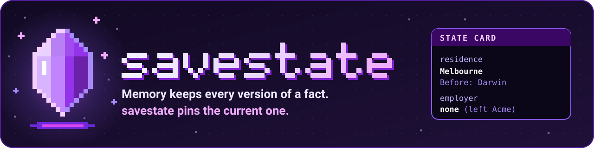
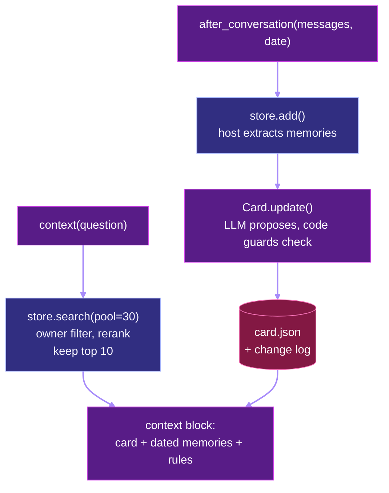

<p align="center">
  
</p>

# savestate

**Memory stores keep every version of a fact. savestate tells the model which one is current.**

Your agent's memory holds "I live in Darwin" from March and "I just moved to Melbourne" from November, and search may
hand the model the wrong one. savestate sits on top of the store you already run (mem0, MemOS or Honcho) and keeps a
small dated **state card**: the current value of each fact that changes, and what it replaced. That card goes in front
of the model with every answer. On a pre-registered benchmark it lifted mem0 from 47% to 71% on facts that change.

```text
STATE CARD:
- User's residence (as of 2026-11-23): Melbourne. Before: Darwin until 2026-11-23.

MEMORIES (date = when it was learned):
1. [2026-03-01] I live in Darwin.
2. [2026-11-23] I just moved to Melbourne.
```

> v0.1.0 · [Apache-2.0](LICENSE) · install from GitHub: the `savestate` on PyPI is an unrelated project

## Quickstart

```bash
pip install "git+https://github.com/pixl-works/savestate.git"
```

```python
from savestate import AnthropicLLM, Layer, Mem0Http

layer = Layer(Mem0Http("http://localhost:8888", user_id="me"), AnthropicLLM(), card_path="card.json")

# after each conversation: your store saves it, the card follows
messages = [{"role": "user", "content": "I just moved to Melbourne."}]
layer.after_conversation(messages, date="2026-11-23")

# before each answer: card + best dated memories + answer rules, as text for your prompt
print(layer.context("Where do I live now?"))
```

`AnthropicLLM` reads `ANTHROPIC_API_KEY` (default model `claude-haiku-5-5`). No server or key at hand?
[docs/examples/offline_demo.py](docs/examples/offline_demo.py) runs the same flow offline and prints the block above.

## How it works



- The model proposes card lines; **code** checks them (a date stamp on every line, fixed facts like birthdays never on
  the card, at most two earlier values), because small models ignore rules that live only in a prompt.
- Every change goes to an append-only log with the memories it came from. Remove savestate and you lose only the card.
- It does not store memories itself, and it barely helps with facts that never change.

## Results

**Pre-registered, on 25 personas nobody had looked at** ([MemConflict](https://arxiv.org/abs/2605.20926), mem0 2.2.1,
Claude Haiku in every role), score in %:

| Question type | mem0 alone | + card | + card and full layer |
|---|---|---|---|
| Facts that change | 47.1 | **70.7** | 69.8 |
| Facts that never change | 50.2 | 52.6 | 50.7 |
| Situational | 65.1 | 66.1 | 66.6 |

The card won on all 25 personas: +23.6 points (95% CI 21.7 to 25.7). The full layer (owner filter on) adds nothing on
top, which is why it is off by default.

Other stores, on the 5 personas savestate was tuned on (facts that change):

| Memory store | Store alone | + card | + card and full layer |
|---|---|---|---|
| MemOS 2.0.36 | 48.6 | not measured | 71.4 |
| Honcho 3.0.9 | 52.4 | **64.3** | 70.4, not recommended |

On Honcho, use the card only: the full layer costs 4.4 points on situational questions. All numbers come from the
research code savestate was extracted from. Re-run them with [bench/memconflict](bench/memconflict/README.md).

## Why not Zep, Letta or Honcho's own card?

Zep/Graphiti and Letta solve this by *being* your memory system; Honcho keeps a card of its own. savestate keeps your
store and adds one file.

## More

- [Guide](docs/guide.md): the full API, all options, the command line and config, security, limits, development setup.
- [Benchmark](bench/memconflict/README.md): how the numbers above are made.
- Bugs and questions: [GitHub issues](https://github.com/pixl-works/savestate/issues).
